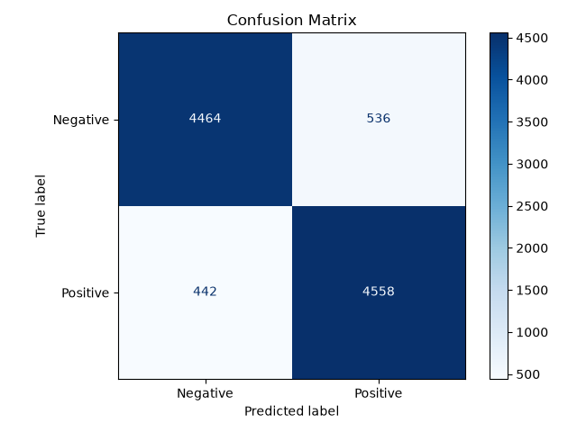

# 🎬 Sentiment Analysis on IMDb Movie Reviews

A Machine Learning pipeline built using **Python**, **TF-IDF Vectorization**, and **Logistic Regression** (Scikit-Learn) to classify 50,000 IMDb movie reviews as either **Positive** or **Negative**.

---

## 📌 Project Overview
Movie reviews provide critical signals about audience reception. However, reading through tens of thousands of unstructured reviews manually is impossible. 

This project implements an end-to-end Machine Learning pipeline that:
1. **Preprocesses** noisy user text (removes HTML tags, handles punctuation, lowercases words).
2. **Converts** text into numerical feature vectors using **TF-IDF** (Term Frequency-Inverse Document Frequency).
3. **Trains** a binary classification model using **Logistic Regression**.
4. **Evaluates** performance using **Accuracy**, **F1-Score**, and a **Confusion Matrix**.
5. **Analyzes errors** (misclassifications) to understand why the model struggles with sarcasm, subtle negatives, or mixed reviews.

---

## 🎯 Problem Statement
Given a raw text movie review written by an IMDb user, predict the binary sentiment label:
* `1` (**Positive**): The reviewer enjoyed the film and recommends it.
* `0` (**Negative**): The reviewer disliked the film.

### Challenges:
* **Noisy Text**: Reviews contain HTML tags (`<br />`), spelling quirks, and punctuation.
* **Large Vocabulary**: 50,000 reviews generate hundreds of thousands of unique words.
* **Complex Language Nuances**: Sarcasm, double negatives, and mixed feelings (e.g., *"The acting was brilliant, but the plot was horrible"*).

---

## 💡 Solution Architecture
The project follows a standard Machine Learning lifecycle:

```
[ Raw IMDb Reviews (50,000) ]
              │
              ▼
   [ Text Preprocessing ]
   (HTML removal, cleaning)
              │
              ▼
    [ TF-IDF Vectorizer ]
  (Turn words into numbers)
              │
              ▼
   [ Train/Test Split ]
   (80% Train | 20% Test)
              │
              ▼
   [ Logistic Regression ]
       (Model Training)
              │
              ▼
    [ Model Evaluation ]
 (Accuracy, F1, Confusion Matrix)
```

---

## 📁 Folder Architecture
```text
Sentiment_Analysis_IMDB_Reviews/
│
├── data/                  # Stores dataset files (raw and processed)
├── src/                   # Python source code modules (preprocessing, vectorization, training)
├── models/                # Saved model weights and vectorizers (.joblib files)
├── notebooks/             # Interactive Jupyter notebooks for experimentation & EDA
├── reports/
│   └── figures/           # Visualizations (confusion matrix, word importance charts)
├── train.py               # End-to-end training and evaluation script
├── predict.py             # CLI and interactive sentiment prediction tool
├── README.md              # Project documentation and summary
└── requirements.txt       # Project dependencies
```

### Why this structure?
* **Modularity**: Keeps code separated into logical pieces instead of one massive, unreadable script.
* **Reproducibility**: Anyone cloning the repository can easily see where data goes, where models are saved, and how to run tests.
* **Professional Standards**: Matches industry-standard ML repository blueprints.

---

## 🛠️ Tech Stack
* **Language**: Python 3.14+
* **Machine Learning**: `scikit-learn`
* **Visualization**: `matplotlib`
* **Model Serialization**: `joblib`

---

## 📊 Dataset Insights
* **Source**: IMDb 50K Movie Reviews Dataset
* **Total Samples**: 50,000 labeled reviews
* **Class Distribution**:
  * Positive: **25,000** reviews (50%)
  * Negative: **25,000** reviews (50%)
  * *(The dataset is perfectly balanced, meaning our model will not be biased toward either sentiment).*
* **Key Observations**:
  * Contains raw web text with HTML line breaks (`<br />`).
  * Features diverse lengths ranging from short 2-sentence reactions to multi-paragraph analytical essays.

---

## 📈 Results & Evaluation

The model was evaluated on a strictly held-out test set of **10,000 unseen reviews** (20% split):

| Metric | Score | Explanation |
| :--- | :---: | :--- |
| **Accuracy** | **90.22%** | Out of 10,000 test reviews, over 9,020 were correctly classified. |
| **Precision** | **89.48%** | When predicting positive, the model is correct 89.5% of the time. |
| **Recall** | **91.16%** | The model captured 91.2% of all actual positive reviews. |
| **F1-Score** | **90.31%** | Strong harmonic balance between precision and recall. |

### Confusion Matrix
The confusion matrix demonstrates strong diagonal dominance (correct predictions) with low false positive and false negative rates:



### 🔍 Error Analysis (Why Did the Model Make Mistakes?)
Analyzing the misclassified reviews revealed three primary failure modes:
1. **Sarcasm and Irony**: Reviews using words like *"masterpiece"* or *"brilliant"* in a mocking tone to describe terrible movies.
2. **Mixed Sentiment**: Reviews where the author praised individual elements (e.g., cinematography, music) before concluding with a negative verdict.
3. **Double Negatives**: Complex phrasing like *"not without its charms"* or *"hardly unwatchable"*.

---

## 🚀 How to Run

### 1. Train the Model
Run the end-to-end training pipeline on the 50,000 reviews:
```bash
python train.py
```

### 2. Predict Custom Reviews
Test any movie review directly via command line:
```bash
python predict.py "This movie was an absolute masterpiece with breathtaking visuals!"
```
Or launch interactive mode:
```bash
python predict.py
```

---

## 🚦 Roadmap & Progress
- [x] **Step 1:** Project setup, directory architecture & `README.md` blueprint
- [x] **Step 2:** Dataset acquisition (IMDb 50,000 dataset) & Exploratory Data Analysis (EDA)
- [x] **Step 3:** Text cleaning and preprocessing module
- [x] **Step 4:** Feature extraction with TF-IDF vectorization
- [x] **Step 5:** Model training with Logistic Regression
- [x] **Step 6:** Model evaluation, confusion matrix & error analysis
- [x] **Step 7:** End-to-end training pipeline & interactive review prediction

